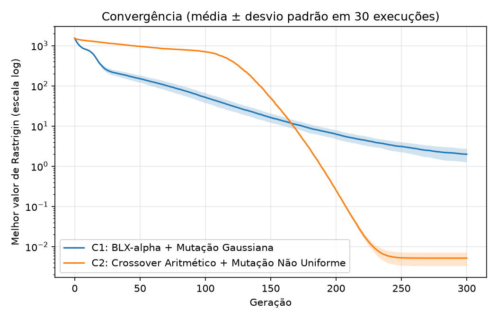
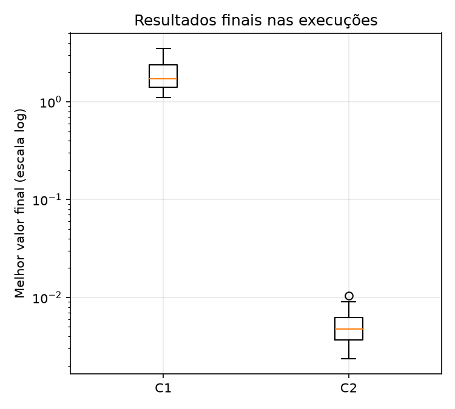

# ppgep-pep309-rastrigin-genetic-algorithm

## Conteúdo do repositório
- `run.py`: Ponto de entrada multiplataforma (Windows, macOS, Linux).
- `src/tune.py`: Script de ajuste de parâmetros do algoritmo genético. O script realiza uma busca em grade (*grid search*) piloto para descobrir os melhores parâmetros de funcionamento dos casos de teste.
- `src/experiment.py`: Experimento final. Roda 30 vezes cada caso de teste (C1, C2), calcula as estatísticas descritivas e grava os resultados em results/ (`runs.csv`, `individuals.csv`, `summary.json`, `convergence.png` e `boxplot.png`).
- `src/ga.py`: Biblioteca do algoritmo genético. Contém a função de Rastrigin, a seleção, os operadores de *crossover* e mutação, os casos de teste (C1, C2) e a execução do AG.

## Como executar?

1. (Opcional) No terminal, execute `python run.py setup` para criar o ambiente virtual (`.venv`) e instalar as dependências de `requirements.txt`.

2. (Opcional) No terminal, execute `python run.py tune` para realizar a *grid search* piloto, gerando `results/tuning.csv` com todas as configurações testadas. Para serem utilizados, os parâmetros gerados em `results/tuning.csv` devem ser manualmente adicionados a `ga.py` (em `default_cases()`). IMPORTANTE: O script `ga.py` já contém os parâmetros escolhidos a partir de uma rodagem passada (ver a seção "Escolha dos parâmetros").

3. No terminal, execute `python run.py experiment` para rodar o experimento final (30 execuções por caso de teste, com a ordem aleatorizada), gerando em `results/` os arquivos `runs.csv`, `individuals.csv`, `summary.json`, `convergence.png` e `boxplot.png`. Use `--runs` e `--seed` para alterar o número de execuções e a semente (padrão: 30 e 2026).

## Casos de teste

Características comuns aos dois casos:
- Representação real, com $n = 100$ variáveis em $[-5,12; 5,12]$ e população inicial aleatória uniforme.
- Critério de parada: 300 gerações.
- Fitness por ranking linear (pressão seletiva $s = 1,8$).
- Seleção por roleta SUS (*stochastic universal sampling*) com elitismo de 2 indivíduos.
- Os genes dos descendentes são limitados a $[-5,12; 5,12]$ após a mutação.

Os casos diferem apenas nos operadores de *crossover* e de mutação:

### C1: BLX-α + mutação gaussiana
Parâmetros escolhidos:
- Tamanho da população ($N$) $= 800$
- Probabilidade de *crossover* ($p_c$) $= 1,0$
- Probabilidade de mutação ($p_m$) $= 0,02$
- $α = 0,1$
- $σ = 0,01$

### C2: crossover aritmético + mutação não uniforme
Parâmetros escolhidos:
- Tamanho da população ($N$) $= 800$
- Probabilidade de *crossover* ($p_c$) $= 1,0$
- Probabilidade de mutação ($p_m$) $= 0,5$
- $b = 7,0$

## Escolha dos parâmetros

Os parâmetros livres (tamanho da população, taxas de *crossover* e de mutação e parâmetros dos operadores) foram escolhidos por uma busca em grade piloto, com `python run.py tune`. A busca foi feita em duas rodadas: a segunda refinou a região da melhor configuração da primeira. Somente a segunda rodada está no repositório (`results/tuning.csv`).

- Cada configuração foi executada 10 vezes, e o critério de comparação é a **média do custo final**.
- As sementes do ajuste (a partir de $1.000.000$) são diferentes das do experimento final, para que os parâmetros não sejam ajustados sobre as mesmas execuções usadas na avaliação.
- Os dois casos usaram as mesmas sementes e o mesmo número de execuções por configuração. O C1 tem mais configurações (144 contra 36) porque tem um parâmetro a mais ($α$).

Grades avaliadas:

| Parâmetro | C1 | C2 |
|-----------|----|----|
| Tamanho da população ($N$) | 400, 800 | 400, 800 |
| $p_c$ | 0,9; 1,0 | 0,9; 1,0 |
| $p_m$ | 0,02; 0,05; 0,1 | 0,2; 0,3; 0,5 |
| Mutação | $σ$ = 0,01; 0,02; 0,05 | $b$ = 4; 5; 7 |
| *Crossover* | $α$ = 0; 0,05; 0,1; 0,2 | (sem parâmetro) |
| Configurações | 144 | 36 |

Três melhores configurações de cada caso (média ± desvio padrão do custo final em 10 execuções):

| Caso | $N$ | $p_c$ | $p_m$ | Operadores | Custo final |
|------|-----:|-----:|-----:|------------|------------:|
| C1 | 800 | 1,0 | 0,02 | $α = 0$; $σ = 0,01$ | 1,68 ± 0,60 |
| C1 | 800 | 0,9 | 0,02 | $α = 0,05$; $σ = 0,01$ | 1,83 ± 0,63 |
| C1 | 800 | 1,0 | 0,02 | $α = 0,05$; $σ = 0,01$ | 1,88 ± 0,77 |
| C2 | 800 | 1,0 | 0,5 | $b = 7$ | **0,0051 ± 0,0016** |
| C2 | 800 | 1,0 | 0,5 | $b = 5$ | 0,0089 ± 0,0029 |
| C2 | 800 | 1,0 | 0,3 | $b = 7$ | 0,0156 ± 0,0036 |

Observações:
- **População:** $N=800$ foi melhor que $N=400$ nos dois casos (melhor média de $1,68$ contra $5,94$ em C1 e de $0,005$ contra $0,027$ em C2). $p_c = 1,0$ foi um pouco melhor que $0,9$.
- **C1:** é sensível a $p_m$ e $σ$. Quanto menores, melhor (melhor média de $1,68$ com $p_m = 0,02$ contra $13,0$ com $p_m = 0,1$; e 1,68 com $σ = 0,01$ contra 14,5 com $σ = 0,05$).
- **C2:** os maiores valores de $p_m$ e de $b$ foram os melhores.
- **C1 e $α$:** a configuração usada ($α = 0,1$; $σ = 0,01$; $p_m = 0,02$) ficou em 5º lugar na ordenação ($1,99 ± 0,74$). A melhor média foi com $α = 0$ ($1,68 ± 0,60$), e a vantagem de $α = 0$ é sistemática: ele venceu $α = 0,1$ nas 36 combinações dos demais parâmetros. Mesmo assim, $α = 0,1$ foi mantido porque, com $α = 0$, o BLX-α se reduz ao *flat crossover*, que gera filhos com a mesma distribuição do crossover aritmético por gene usado no C2; os dois casos deixariam de diferir no operador de *crossover*.
- Os valores escolhidos estão em `default_cases()`, em `src/ga.py`.

## Resultados

Resultados de `python run.py experiment` (30 execuções independentes por caso de teste, semente mestra $2026$, 300 gerações, $n = 100$ variáveis). O valor ótimo da função de Rastrigin é $0$, portanto **quanto menor o custo final, melhor**. Os dados completos estão em `results/` (`runs.csv`, `individuals.csv`, `summary.json`, `convergence.png` e `boxplot.png`).

### Melhor e pior indivíduos, média e desvio padrão

Estatísticas do custo final (melhor indivíduo de cada execução) nas 30 execuções:

| Caso | Melhor | Pior | Média | Desvio padrão |
|------|-------:|-----:|------:|--------------:|
| C1: BLX-α + mutação gaussiana | 1,1065 | 3,5092 | 1,9909 | 0,7395 |
| C2: crossover aritmético + mutação não uniforme | 0,002381 | 0,010424 | 0,005181 | 0,001901 |

- **Melhor** e **pior** são o menor e o maior custo final entre as 30 execuções.
- O desvio padrão é amostral ($ddof = 1$).
- Os **vetores** do melhor e do pior indivíduos de cada caso (as 100 variáveis, em precisão total) estão em `results/individuals.csv`, com uma linha por caso e tipo (`best`/`worst`), a execução de origem e o custo. O custo gravado é recalculado a partir do vetor, e pode ser conferido na Equação de Rastrigin:

$$f(x) = 10n + \sum_{i=1}^{n} \left[x_i^2 - 10\cos(2\pi x_i)\right]$$

### Tempo médio de execução

| Caso | Tempo médio por execução |
|------|-------------------------:|
| C1 | 0,858 s |
| C2 | 1,025 s |

### Convergência e distribuição dos resultados

### Teste T pareado

Hipóteses: $H_0: C_1 = C_2$ contra $H_1: C_1 \neq C_2$, com nível de significância $\alpha = 0,05$. O pareamento é feito pela execução: a execução $i$ de C1 e a execução $i$ de C2 partem da mesma população inicial (mesma semente), com fluxos aleatórios de evolução independentes.

| Estatística | Valor |
|-------------|------:|
| Diferença média ($C_1 - C_2$) | 1,9857 |
| Estatística $t$ | 14,70 |
| Graus de liberdade | 29 |
| ***p-value*** | $5,64 \times 10^{-15}$ |

### Considerações e conclusões

- **Teste de hipótese:** o *p-value* ($5,64 \times 10^{-15}$) é muito menor que $0,05$, então **rejeita-se $H_0$**: os casos de teste são estatisticamente diferentes.
- **Qualidade:** o C2 obteve custo médio cerca de 380 vezes menor que o C1 (0,0052 contra 1,99), com menor dispersão. O melhor resultado do C1 (1,1065) é pior que o pior do C2 (0,0104). O boxplot mostra os dois casos sem sobreposição.
- **Comportamento ao longo das gerações:** o C1 cai rápido no início, mas desacelera e ainda decresce lentamente na geração 300. O C2 fica quase parado por cerca de 100 gerações, depois cai rapidamente, ultrapassa o C1 por volta da geração 165 e estabiliza perto da geração 250.
- **Tempo:** o C2 levou cerca de 19% mais tempo por execução (1,025 s contra 0,858 s), diferença pequena frente à diferença de qualidade.
- **Robustez do teste:** o teste de Shapiro-Wilk indicou que as diferenças pareadas não seguem distribuição normal ($p \approx 0,0025$), o que enfraquece o pressuposto do teste T. O teste de Wilcoxon pareado, que não exige normalidade, leva à mesma conclusão ($p \approx 1,9 \times 10^{-9}$).

### Limitações

- Os melhores valores da grade ficaram nas bordas dela: em C1, os menores $p_m$ e $σ$; em C2, os maiores $p_m$ e $b$ (e, nos dois casos, população 800 e $p_c = 1,0$). O ótimo real pode estar fora das faixas testadas, e nem o tamanho da população nem $s$ e o número de elitistas foram explorados mais a fundo.
- Os parâmetros foram ajustados com apenas 10 execuções por configuração, de modo que a ordenação entre configurações vizinhas é incerta (exceto quando a diferença se repete em toda a grade, como no caso de $α$).
- Todos os números dependem da semente mestra $2026$ e de 30 execuções.
